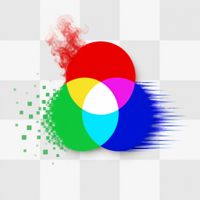

# ISFLab



**Browse, preview and edit ISF shaders.**
A desktop app by **Pixel Stereo** for macOS, Windows and Linux.

- **Browse** generators, filters and transitions by name, type or category.
- **Preview** filters with an animated test card and transitions with looping **BEFORE / AFTER** cards. Use your own images, ISF generators or live feeds via Syphon, Spout or GStreamer shared memory.
- **Edit** GLSL alongside a visual editor for inputs and passes. Save your preview settings as shader defaults.
- **Export** filtered shaders to a folder or ZIP with their vertex shaders, images and relative paths intact.

## Download

<!-- release-downloads:start -->
Latest build **[v0.1.8](https://github.com/PixelStereo/ISFLab/releases/tag/v0.1.8)**

[macOS ARM64](https://github.com/PixelStereo/ISFLab/releases/download/v0.1.8/ISFLab-macOS-arm64-v0.1.8.zip) · [Windows x64](https://github.com/PixelStereo/ISFLab/releases/download/v0.1.8/ISFLab-Windows-x64-v0.1.8-Setup.exe) · [Linux x64](https://github.com/PixelStereo/ISFLab/releases/download/v0.1.8/ISFLab-Linux-x64-v0.1.8.tar.gz)
<!-- release-downloads:end -->

Starting with the next release, Windows x64 is distributed as a single installer that bundles the required runtime libraries and adds ISFLab to the Start menu.

## Quick start

Clone with `git clone --recurse-submodules https://github.com/PixelStereo/ISFLab.git`.

Build with **Qt 6.5+** (Widgets, OpenGL, OpenGL Widgets and Multimedia), **CMake 3.21+** and a **C++17** compiler.

```sh
./build.sh
```

On Windows, run `build.cmd` from a Visual Studio developer shell with Qt on CMake’s search path. For live input on Linux, build with the GStreamer development libraries and install the shared-memory plugin.

Open **File → Load examples** to try all three shader types.

Push a version tag such as `v0.0.1` to publish macOS, Windows and Linux archives through GitHub Actions.

[ISF documentation](https://docs.isf.video/)
